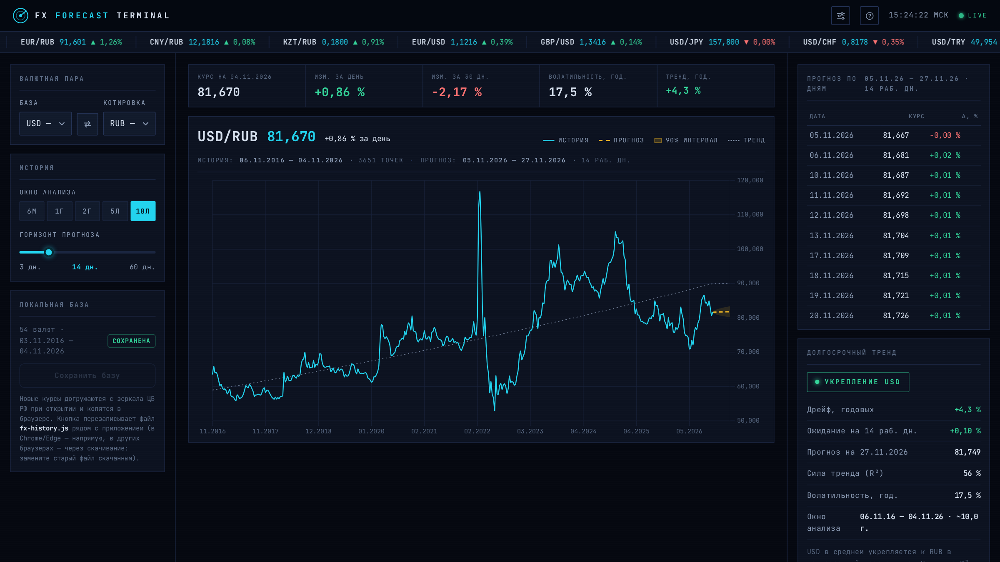

# MacroPulse

Автономный аналитический терминал по макроэкономике и финансовым рынкам РФ. Данные — официальные источники (ЦБ РФ, MOEX), ценность — в анализе и прогнозе, а не в простом показе цифр. Работает без серверов, VPN и внешних CDN: страницу можно открыть прямо с диска.

**Онлайн-версия:** https://ygadalov.github.io/macropulse/ — база курсов обновляется автоматически каждый день (GitHub Actions), ручные действия не нужны.

## Разделы

- **FX Forecast Terminal** (текущий) — курсы 54 валют ЦБ РФ и 48 валют НБК (тенге) с переключателем источника, история 10 лет, ансамблевый прогноз (damped Holt + Theta + дрейф) на 3–60 рабочих дней с полосой 90 %, долгосрочный тренд, средние и волатильность по периодам.

В планах: ставки и ОФЗ, инфляция, RUONIA, индексы MOEX — см. [docs/roadmap.md](docs/roadmap.md).

## Что умеет FX Forecast Terminal

- **Курс и динамика**: карточки «Курс на …», изменение за день и за 30 дней, волатильность и тренд в годовом выражении; курсы — 4 знака после запятой, как публикует ЦБ.
- **Метка T+1**: вечером после установки ЦБ (~15:00 МСК) завтрашний курс уже в базе — бейдж T+1 в карточке и пунктирный хвост с янтарной точкой на графике; в полночь метка исчезает сама.
- **График**: история + прогноз с полосой 90 % + долгосрочный тренд; окна 6М / 1Г / 2Г / 5Л / 10Л / MAX.
- **Прогноз по дням**: таблица с границами полосы 90 % на каждый день; строки-дубли (вс)/(пн) — в выходные действует субботняя установка ЦБ.
- **Средние по периодам**: разбивка окна по месяцам/кварталам/годам, средний курс (взвешен по календарным дням действия установки) и годовая волатильность с цветовой градацией (<7 % / 7–12 % / 12–20 % / >20 %).
- **Бегущая строка** котировок, складной рельс разделов, контекстные настройки и справка, адаптивная раскладка от десктопа до телефона.

## Быстрый старт

**Онлайн (рекомендуется):** просто откройте https://ygadalov.github.io/macropulse/ — данные всегда свежие.

**Локально:**
1. Скачайте репозиторий (Code → Download ZIP) и распакуйте.
2. Откройте `index.html` двойным кликом — всё работает сразу, интернет не нужен.
3. При открытии с интернетом догружаются только новые дни с зеркала курсов ЦБ; панель «Локальная база» покажет «+N дн. не сохранено».
4. Кнопка **«Сохранить базу»** перезаписывает `fx-history.js` (в Chrome/Edge — напрямую в тот же файл, в Firefox/Safari — через скачивание с тем же именем).

## Архитектура в двух словах

Чистая статика: `index.html` + `src/` (JS/CSS, Chart.js и шрифты — локально). Базы курсов — `fx-history.js` (`window.FX_HIST`, ~2 МБ, 10 лет × 54 валюты ЦБ РФ) и `kzt-history.js` (`window.KZT_HIST`, ~2 МБ, с 2016 × 48 валют НБК). Дельта ЦБ РФ догружается из браузера с зеркала (cbr-xml-daily.ru, JSON + CORS, резервный JSONP-канал); у API НБК CORS закрыт, поэтому его базу обновляет только ежесуточный GitHub Action (`scripts/update-history.mjs` + `scripts/update-kzt-history.mjs`), локальная копия ЦБ копит дельту в браузере до сохранения в файл. Подробно — [docs/spec.md](docs/spec.md), история изменений — [CHANGELOG.md](CHANGELOG.md).

## Источники данных и ограничения

- **Курсы валют** — официальные курсы ЦБ РФ (cbr.ru) и Национального банка Казахстана (nationalbank.kz), общедоступные данные.
- **Зеркало** cbr-xml-daily.ru — открытый JSON API курсов ЦБ, используется для догрузки дельты.
- Планируемые данные **MOEX ISS** (iss.moex.com) — для личного/внутреннего использования; публичная републикация данных MOEX регулируется их условиями.

Прогнозы носят статистический характер и **не являются инвестиционной рекомендацией**.

## Лицензия

Код — MIT (см. [LICENSE](LICENSE)). На данные источников лицензия MIT не распространяется.
